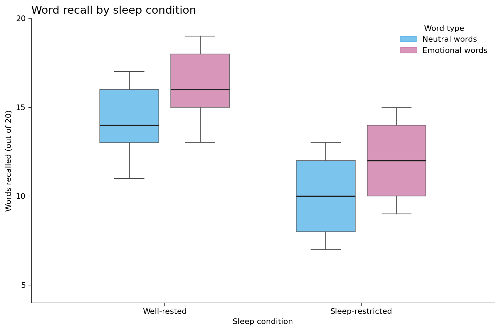

```{r load-pkg, message = FALSE, eval = FALSE}

library(tidyverse)

```

## Background

Researchers tested whether sleep restriction affects memory for emotional and neutral words. Participants were assigned to either a well-rested condition with eight hours of sleep or a sleep-restricted condition with four hours of sleep. The next morning, participants completed a recall task containing 20 neutral words and 20 emotional words.

Your goal is to import, reshape, clean, recode, and filter the data so that you can reproduce the target figure below.



## The data

The file `sleep_memory_messy.csv` contains one row per participant:

- `participant_id`: anonymous participant ID
- `age`: participant age in years
- `sleep_group`: assigned sleep condition
- `test_order`: whether neutral or emotional words were tested first
- `neutral_recall`: number of neutral words recalled
- `emotional_recall`: number of emotional words recalled
- `attention_check`: whether the participant passed an attention check

The data begin in **wide format**, with neutral and emotional recall in separate columns. The dataset also includes inconsistent categorical labels, numeric values stored as text, missing-value codes, exact duplicates, failed attention checks, and impossible recall scores.

## Import and inspect the data

Import the data as an object named `memory_raw` and specify the missing-value codes you identify.

```{r import-data, eval = FALSE}

# YOUR CODE HERE

```

Inspect the variable types and categorical values.

```{r inspect-data, eval = FALSE}

# Suggested functions:
# glimpse()
# nrow()
# count()
# unique()

```

Questions to consider:

- Which variables should be numeric?
- Which labels represent the same sleep condition?
- Which values indicate a passed attention check?
- Why is the current wide format inconvenient for making a grouped boxplot?

## Clean, reshape, and recode the data

Create an object named `memory_clean`. Your pipeline should:

1. Remove exact duplicate rows.
2. Standardize participant-ID capitalization.
3. Extract numeric age.
4. Recode sleep condition as `Well-rested` or `Sleep-restricted`.
5. Recode test order as `Neutral first` or `Emotional first`.
6. Recode attention-check performance as `TRUE` or `FALSE`.
7. Use `pivot_longer()` to place the two recall columns into a `word_type` column and a recall-value column.
8. Recode word type as `Neutral words` or `Emotional words`.
9. Extract the numeric recall score.
10. Keep participants who passed the attention check and scores between 0 and 20.

```{r clean-data, eval = FALSE}

memory_clean <- memory_raw %>%
  # YOUR CODE HERE

```

Check the cleaned data before plotting.

```{r check-cleaning, eval = FALSE}

# Examine the values and counts for sleep condition and word type.
# Look for missing or impossible recall scores.

```

## Create the target boxplot

When `memory_clean` is correct, the following code should reproduce the target figure.

```{r target-boxplot, fig.width = 9, fig.height = 6, eval = FALSE}

ggplot(
  memory_clean,
  aes(
    x = sleep_condition,
    y = recall_score,
    fill = word_type
  )
) +
  geom_boxplot(
    position = position_dodge(width = 0.80),
    width = 0.65,
    alpha = 0.78
  ) +
  scale_x_discrete(
    limits = c("Well-rested", "Sleep-restricted")
  ) +
  scale_y_continuous(
    breaks = c(5, 10, 15, 20)
  ) +
  coord_cartesian(ylim = c(4, 20)) +
  scale_fill_manual(
    values = c(
      "Neutral words" = "#56B4E9",
      "Emotional words" = "#CC79A7"
    ),
    breaks = c("Neutral words", "Emotional words")
  ) +
  labs(
    title = "Word recall by sleep condition",
    x = "Sleep condition",
    y = "Words recalled (out of 20)",
    fill = "Word type"
  ) +
  theme_classic()

```

If the boxes differ from the target, check the number of observations in each sleep-condition-by-word-type group. Then inspect your missing-value, attention-check, and valid-range filters.

## Reflection

- Why was `pivot_longer()` needed for this visualization?
- What does each box represent?
- How could failed attention checks, impossible scores, or duplicate participants change a boxplot?

