<!-- Reconstructed from the rendered HTML. Static images require the original
     hexes/ and img/ folders; plots generated by R will be recreated when rendered. -->

{.absolute top="-20" right="0" width="64" height="74"}

# PART 1: What are tidyModels?

#### A modeling framework!
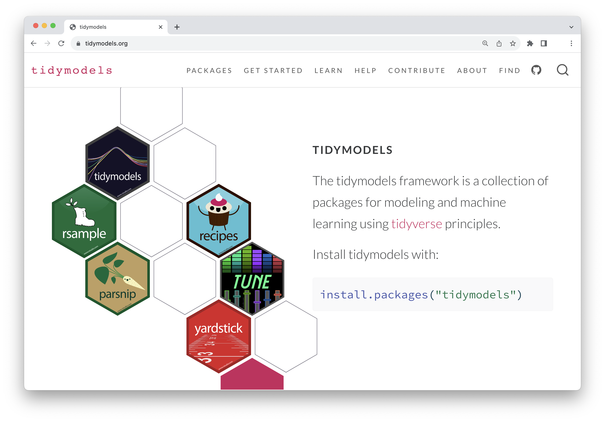{.img-fluid}

<!-- -->

```{r warning=FALSE}
#| label: load-tm
#| message: false
library(tidymodels)
```

### What we will be working on today
-   A simplified predictive modeling workflow.

## Machine learning as a predictive modeling process

<figure class="figure" style="margin-bottom: 60px; text-align: center;">
  <p>
    
  </p>
</figure>

<figure class="figure" style="margin-bottom: 60px; text-align: center;">
  <p>
    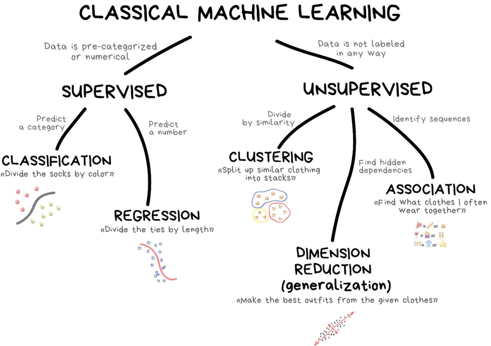
  </p>
</figure>

::: {.callout-note}
## INSTRUCTOR NOTE

This figure divides classical machine learning into two broad families: supervised and unsupervised learning. The key distinction is whether we have a known outcome that we want the model to predict.

In supervised learning, every observation in our training data has a known outcome, sometimes called a label. We use those examples to learn a relationship between the predictors and the outcome. The outcome is already known in the training data.

If the outcome is a category, we call it classification. For example, we might predict whether a taxi passenger leaves a tip: yes or no.

If the outcome is a numerical quantity, we call it regression. For example, we might predict the dollar amount of a tip or the distance of a taxi trip.

If we want to predict whether a trip was local versus non-local (binary variable), which would we use? CLASSIFICATION

If we want to predict how many miles a ride is, which would we use? REGRESSION

Our taxi example is supervised learning, specifically a classification problem, because the training data tell us whether each passenger tipped and we are predicting the categories ‘yes’ and ‘no.’

In unsupervised learning, we do not begin with a known outcome to predict. Instead, we ask the algorithm to identify useful structure or patterns in the data. I'll briefly describe this since it's not our focus today.

Clustering groups observations that are similar. For example, we might discover different types of taxi trips based on their distance, time of day, location, and cost—without specifying those groups in advance.

Dimension reduction takes many related variables and summarizes them with a smaller number of dimensions. Principal components analysis, or PCA, is one example.

Association methods look for items or events that tend to occur together. The classic example is discovering which products people frequently purchase together.

For today, we are staying entirely on the left side of this diagram. We have a labeled outcome—whether a passenger tipped—and we want to predict a category. That makes this a supervised classification problem.
:::

<figure class="figure" style="margin-bottom: 60px; text-align: center;">
  <p>
    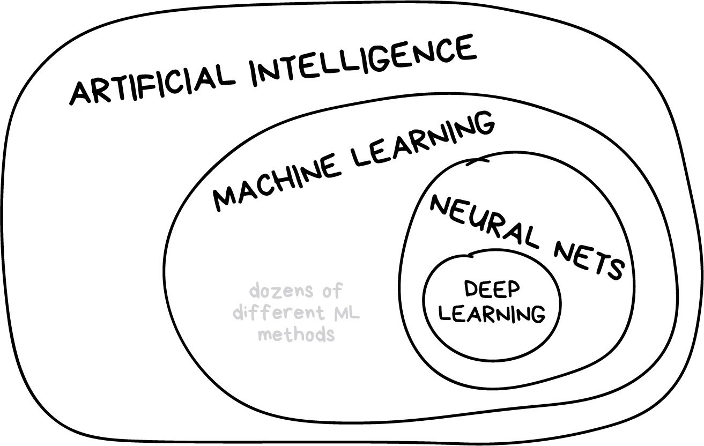
  </p>
</figure>

::: {.callout-note}
## INSTRUCTOR NOTE

This figure show the relation among four commonly confused terms. These terms are related, but they are not interchangeable. Each smaller area represents a more specific set of methods within the larger area.

Artificial intelligence is the broadest category. It refers to computer systems designed to perform tasks that we associate with intelligent behavior—such as reasoning, planning, recognizing patterns, understanding language, or making decisions.

Importantly, not all AI uses machine learning. Traditional rule-based systems, search algorithms, and expert systems can be considered AI even though they do not learn patterns from data.

Machine learning is one approach to artificial intelligence. Instead of programming every decision rule directly, we give the computer data and allow it to estimate patterns that it can use to make predictions or decisions. The logistic-regression and decision-tree models we will use today are machine-learning methods. They learn relationships from the taxi data and then use those relationships to predict whether a new passenger will leave a tip.

Neural networks are one particular family of machine-learning models. They consist of connected layers of units—sometimes called artificial neurons—that learn increasingly complex relationships in the data.

Deep learning uses neural networks with multiple layers, or steps, to learn complex patterns from data and make predictions. These kind of models do things like speech recognition, natural language processing, image recognition, etc.  

Today we are working inside the machine-learning circle, but outside the neural-network circle. Logistic regression and decision trees are machine-learning models, but they are not neural networks or deep-learning models. 

Is every Deep Learning Model a Machine Learning Model? YES

Is every Machine Learning Model a Deep Learning Model? NO

The decision tree we will use today is a machine-learning model but not a neural network (so it’s out in the ML circle).

:::

{.absolute top="0" right="0" width="150" height="150"}

## Your turn
-   ### *How are statistics and machine learning related?; How are they different?*

<!-- -->

::: {.callout-caution collapse="true"}
## Only open when you have researched your answers for these questions

Statistics and machine learning both use data to identify patterns, build models, and make predictions. Statistics often emphasizes explanation, inference, and uncertainty, whereas machine learning often emphasizes predictive performance on new data—but the two fields overlap substantially. 

They are sometimes thought of as capturing "two cultures:" Model first vs. data first; or inference vs. prediction
:::

## The whole game
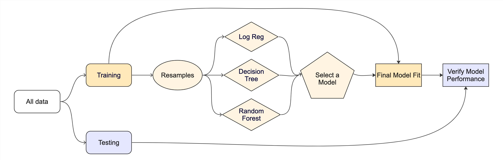{.img-fluid}


::: {.callout-note}
## INSTRUCTOR NOTE

This diagram shows the complete predictive-modeling process. The later figures highlight one portion at a time. The most important thing to watch is which data we are allowed to use at each stage.

We begin with all our data and split it into training and test sets. We use the training data to develop the model. We can do things like fit multiple candidate models, compare their performance, and select one. We then fit the selected model using the full training set and evaluate it once on the test set.

Splitting Data: Our first decision is how to spend our available data. Most of it becomes the training set, which we can use to build and compare models. The remainder becomes the test set, which we set aside and do not use during model development. Data are limited, so putting more observations in the training set gives us more information for fitting the model, while putting more in the test set gives us a more precise final evaluation. We need enough data for both purposes.

We can start with one candidate model. Here, we will begin by specifying a decision-tree model so that we have a candidate model to work with. This is not yet our final model.

The diagram highlights the decision tree first because it is the model we are using to demonstrate the model-building process. We then apply the same process to other candidate models and compare all of them using the same resampled training data. 

Next, we use only the training data to evaluate multipe different candidate models. Cross-validation repeatedly divides the training data into smaller analysis and assessment sets. We fit each model on an analysis set and evaluate it on the corresponding assessment set. We could just identify multiple candidate models from the start rather than choosing the decision tree. 

This gives us several estimates of performance instead of relying on one fortunate or unfortunate split. We can compare models using their average performance and the variability across folds.The test set is still untouched. Cross-validation occurs entirely within the training set.

After comparing the candidates, we select the model and preprocessing procedure we want to use. We then fit that finalized model using all of the training data.

Only now that we've decided on our model do we bring back the test set. The finalized model predicts the test observations, and we calculate our final performance metrics. This provides an independent estimate of how the model may perform on similar new data.

If we examine the test results and repeatedly change the model to improve them, the test set becomes part of model development and is no longer an independent final test.

**Develop and compare models using the training data; use the test data only after the modeling decisions are finalized**

:::

### Splitting data (aka your data budget) and building a decision tree
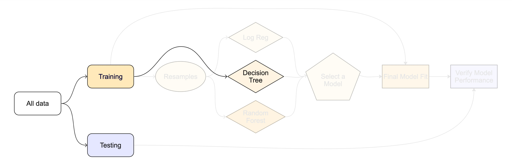{.img-fluid}

### Cross validation, i.e., resampling
-   Comparing multiple model types and evaluating to identify best one

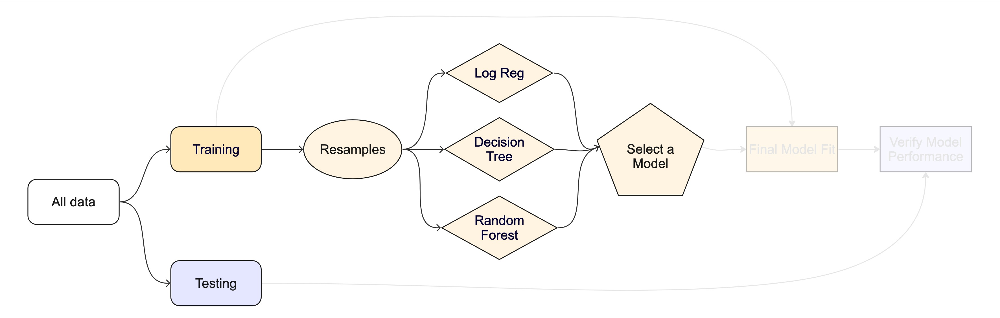{.img-fluid}

### Creating a final model fit object and doing a final test
{.img-fluid}

# Data

## Taxi trips in Chicago in 2022
{.img-fluid}

The city of Chicago releases anonymized trip-level data on taxi trips in the city. We will use a dataset that pulls a sample of 10,000 rides occurring in early 2022.

<!-- -->

::: {.callout-tip}
## Tip


Type `?taxi` to learn more about this dataset, including references.
:::


<!-- -->

```{r}
library(tidymodels)
```


<!-- -->

```{r}
glimpse(taxi)
```

<!-- -->

::: {.callout-note}
## Note


`tip`: Whether the rider left a tip. A factor with levels "yes" and "no".

`distance`: The trip distance, in odometer miles.

`company`: The taxi company, as a factor. Companies that occurred few times were binned as "other".

`local`: Whether the trip started in the same community area as it began. See the source data for community area values.

`dow`: The day of the week in which the trip began, as a factor.

`month`: The month in which the trip began, as a factor.

`hour`: The hour of the day in which the trip began, as a numeric.
:::

### Checklist for predictors
-   Is it ethical to use this variable? (Or even legal?)
-   Will this variable be available at prediction time?
-   Does this variable contribute to explainability?

::: {.callout-note}
## INSTRUCTOR NOTE

ETHICAL: Suppose the dataset included a passenger’s race, disability status, or a neighborhood variable that closely functions as a proxy for race or income. Even if the variable improves prediction, using it could produce discriminatory decisions. We should ask whether the variable is appropriate for the intended use—not merely whether it is statistically useful.

AVAILABLE: Suppose we want to predict whether a passenger will tip when the trip begins, but one predictor is the trip’s final duration. Final trip duration might predict tipping, but we do not know it when the trip begins. Using it would give us an unrealistic impression of how well the model can perform in practice. This is sometimes called data leakage: the model receives information during development that would not actually be available when making a prediction. 

CONTRIBUTE: Compare trip_distance with an arbitrary passenger or transaction ID. Trip distance is meaningful: we can explain how predicted tipping changes with distance. An arbitrary ID number has no meaningful interpretation, even if the model discovers an accidental pattern involving it. 

Overall, a predictor should not be included simply because it improves accuracy. We should also ask whether using it is appropriate, realistic, and understandable.

:::

# PART 2: Data Budget

{.absolute top="-20" right="0" width="64" height="74"}

## Data splitting and spending
Always have a separate piece of data that can contradict what you believe!

For machine learning, we typically split data into training and test sets:

-   The **training set** is used to estimate model parameters.
-   The **test set** is used to find an independent assessment of model performance. Do not 🚫 use the test set during training. The test set is precious 💎

<figure class="figure">
<p>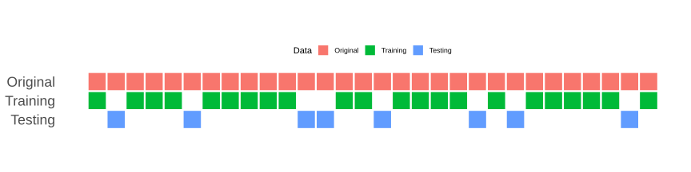</p>
</figure>

-   Spending too much data in **training** prevents us from computing a good assessment of predictive **performance**.

-   Spending too much data in **testing** prevents us from computing a good estimate of model **parameters**.

{.absolute top="0" right="0" width="150" height="150"}

## Your turn
-   ### *When is a good time to split your data?*

::: {.callout-note}
## INSTRUCTOR NOTE

Split the data as early as possible so that the test set remains genuinely unseen. After the split, we use only the training data to explore patterns, make modeling decisions, and estimate preprocessing steps. We return to the test set only after finalizing the model.

:::

## The initial split

<!-- -->

```{r}
#| label: taxi-split
set.seed(123)
taxi_split <- initial_split(taxi)
taxi_split
```

<!-- -->

::: {.callout-note}
## How much data in training vs testing?


This function uses a good default, but this depends on your specific goal/data. There are more powerful ways of splitting, like stratification, that we will get into later.
:::

<!-- -->

::: {.callout-note}
## What is set.seed()?


To create that split of the data, R generates "pseudo-random" numbers: while they are made to behave like random numbers, their generation is deterministic give a "seed".

This allows us to reproduce results by setting that seed.

Which seed you pick doesn't matter, as long as you don't try a bunch of seeds and pick the one that gives you the best performance.
:::

## Accessing the data

<!-- -->

```{r}
#| label: taxi-train-test
taxi_train <- training(taxi_split)
taxi_test <- testing(taxi_split)
```

### The training set

<!-- -->

```{r}
#| label: taxi-train
taxi_train
```

### The test set

DON'T PEEK! 🙈

There are 2500 rows and 7 columns in the test set.

{.absolute top="0" right="0" width="150" height="150"}

## Your turn
-   ### *Split your data so 20% is held out for the test set and show the first 10 rows of so of the training data*

-   ### *Try out different values in `set.seed()` to see how the results change.*
## Exploratory data analysis
As you know by now, before we get too far into our data analysis, we want to do some exploration with visualizations. So lets get to it.

{.absolute top="0" right="0" width="150" height="150"}

## Your turn
-   ### *What's the distribution of the outcome, `tip`?*
-   ### *What's the distribution of numeric variables like `distance`?*
-   ### *How does `tip` differ across the categorical variables?*

<!-- -->

::: {.callout-caution collapse="true"}
## Open only after you’ve attempted to generate a few plots on your own

For `taxi-tip-counts`, what about using `geom_bar()` with just `tip`?

For `taxi-tip-by-distance`, I would recommend `geom_histograms` and play around with the bin size. You will also want to incorporate `facet_grid`.

For `taxi-tip-by-hour`, I would plot making use of `fill=` and `geom_bar`

For `taxi-tip-by-local`, I'll leave this one up to you, but add a colore palette for color-blind people.
:::

## Split smarter
Our EDA showed that the dataset contains fewer "no" tip outcomes than "yes" tip outcomes. With a completely random split, one partition could receive disproportionately few "no" observations.

Stratified sampling performs the split separately within each outcome category. This helps the training and test sets retain approximately the same proportion of "yes" and "no" outcomes as the original dataset.

**Stratified sampling** would split within response values

<!-- -->

::: {.callout-caution collapse="true"}
## Proof that there are fewer “no” tips through EDA

<figure class="figure">
<p>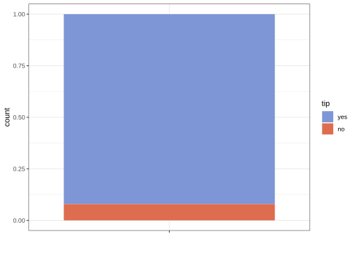</p>
</figure>
:::

<!-- -->

::: {.callout-tip}
## Tip


- Regression: Because the outcome is continuous, stratification can divide its values into ranges—often quantile-based groups—and sample within those ranges. This helps both sets represent the full outcome distribution.

- Time-series data: We generally preserve chronological order rather than randomly splitting. We train on earlier observations and assess performance on more recent observations, which better matches prediction in practice.

:::

{.absolute top="0" right="0" width="150" height="150"}

## Your turn
-   ### *Go back and modify your earlier code where you split the data to stratify by tip*
# PART 3: Do It the tidyModels Way: Building a Model Step-by-Step

In tidyModels, building a model follows three main steps:

1.  Choose a Model Type -- What kind of model do we need? Linear regression? Logistic regression? A decision tree?

2.  Specify an Engine -- How do we want to fit this model? Each model can be fit using different tools, known as "engines."

3.  Set the Mode -- Are we predicting a category (classification) or a number (regression)?

Let's walk through each step and see examples along the way!

### Step 1: Choose a Model Type
The model type determines the basic approach for how we'll make predictions. 

After deciding whether we have a regression or classification problem, we choose a model type. Different models make different assumptions and learn patterns in different ways. There is rarely one model that is automatically best, so we often compare several using resampling.

Here are a few examples:

-   Linear Regression: Good for predicting numbers, like predicting the price of a house.

-   Logistic Regression: Useful for binary categories, like predicting whether a customer will tip (yes or no).

-   Decision Tree: Can be used for either regression (predicting numbers) or classification (predicting categories). Creates a series of if/then rules by repeatedly splitting the data.

To see all the available model types in tidyModels, check out this list of models: <https://www.tidymodels.org/find/parsnip/>

**Example:** Let's start with a basic linear regression model. This type of model is used when we want to predict a continuous number, such as predicting house prices.

<!-- -->

```{r}
linear_reg()
```

This code sets up a linear regression model with the default settings, which includes a default engine (lm for linear model).

Now let's look at a logistic regression model. This type of model is used when we want to predict a binary outcome with two possible categories, such as whether a taxi passenger will leave a tip ("yes" or "no").

```{r}
logistic_reg()
```

### Step 2: Specify an Engine
An engine is the underlying R package or function that performs the model fitting. The model type is the general method; the engine is its specific software implementation.

::: {.callout-note}
## INSTRUCTOR NOTE

The model type tells us what kind of model we want to fit. The engine tells tidymodels which R package and function should do the actual fitting.

You can think of the model type as the recipe and the engine as the appliance used to carry it out. Two appliances might follow the same general recipe, but use somewhat different procedures. In this class, I will tell you which engine to use—we are not choosing among them arbitrarily.

We rpart is the underlying R software that builds our decision tree. It searches for predictor values that divide the observations into groups that are increasingly similar in their outcomes.

:::

For example:

- `linear_reg()` typically uses the `"lm"` engine.
- `logistic_reg()` typically uses the `"glm"` engine.
- `decision_tree()` typically uses the `"rpart"` engine.
- `rand_forest()` commonly uses the `"ranger"` engine.

Some model types have multiple possible engines. Alternative engines may use different estimation methods, such as regularization, Bayesian estimation, or distributed computing. However, not every engine is available for every model type.

**Example:** Let's specify the engine for linear regression as glm, which is often used for logistic or generalized models.

<!-- -->

```{r}
linear_reg() %>% 
  set_engine("glm")
```

Here, `linear_reg()` identifies the model type, while `set_engine("glm"`) tells tidymodels to fit it using R’s glm() function.

Now, if we wanted to use Stan for Bayesian regression, we can change the engine like this:

<!-- -->

```{r}
linear_reg() %>%
  set_engine("stan")
```

This flexibility allows us to choose the best method for our data and problem.

### Step 3: Set the Mode
The mode tells tidyModels whether our goal is regression (predicting a number) or classification (predicting a category). Some models have a default mode, while others require us to specify it.

-   Regression Mode: Use for predicting a number (like house prices).

-   Classification Mode: Use for predicting categories (like whether a customer will tip).

**Example:** Let's set up a decision tree model. A decision tree can be used for either classification or regression, so we need to set the mode explicitly if it's not clear from the context.

<!-- -->

```{r}
decision_tree() %>% 
  set_mode("classification")
```

Here, we're setting the decision tree to classification mode, which tells tidyModels that we're using it to predict categories.

## Summary
1.  Choose a Model -- Decide on the model type based on what you're predicting.
2.  Specify an Engine -- Choose the fitting method, like lm for a linear model or glmnet for regularized regression.
3.  Set the Mode -- Set whether it's a classification or regression model.

This setup gives us a lot of flexibility to try different modeling techniques and see what works best. The goal is to keep our code clear and reusable, letting us focus on finding the best model for our data.

{.absolute top="0" right="0" width="150" height="150"}

## Your turn
-   ### *Edit the code to create a logistic regression model*

<!-- -->

```{r}
#| eval: false
# Model: Specify a logistic regression model

# Engine: Set the engine to "glm" for logistic regression

# Add the mode (some models have a default mode, others don't)
```

## Models we'll be using today
-   Decision trees (me)
-   Logistic regression (you)

### Logistic regression
**The concept of odds and probability:**

-   The **probability** of some event happening can be expressed as a value between 0 and 1

-   If the probability of an event occurring is [\\({p}\\)]{.math .inline}, the **odds** of an event occurring can be expressed as [\\(\\frac{p}{1 - p}\\)]{.math .inline}

"If there is a 75% chance (or 0.75 probability) that it will rain today, then... the odds of it raining are 3 to 1, meaning that it is 3 times more likely to rain than not."

**From odds to log-odds:**

-   Probabilities are restricted to values between 0 and 1, and odds are restricted to positive values.

-   A linear equation, however, can produce values anywhere from negative infinity to positive infinity.

-   Taking the logarithm of the odds puts them on this unrestricted scale, allowing logistic regression to model the outcome using a linear combination of the predictors.

-   The model’s results can then be converted back into probabilities that are easier to interpret.

::: {.callout-note}
## INSTRUCTOR NOTE

Logistic regression does its calculations using log-odds because that scale works with a linear equation. We usually convert the results back into probabilities when we want to interpret or communicate the predictions.

:::

**The Logistic Regression Equation:**

[\\(log(\\frac{p}{1 - p}) = \\beta_0 + \\beta_1\\cdot \\text{A}\\)]{.math .inline}

-   [\\(log(\\frac{p}{1 - p})\\)]{.math .inline} is the log-odds (or the logit) of the probability of our event of interest (e.g., getting a tip)

-   [\\(\\beta_0\\)]{.math .inline} is the intercept, which represents the log-odds of the event when predictor A is zero

-   [\\(\\beta_1\\cdot \\text{A}\\)]{.math .inline} is the slope of coefficient for predictor `A`, indicating how much the log-odds of the event changes with a one-unit change in `A`


**Relating this back to taxi's and tips**

-   We want to predict whether someone will tip ("one") or not based on the trip distance, in odometer meters (`A`).

-   [\\(\\beta_0\\)]{.math .inline} would represent the log-odds of receiving a tip with zero distance

-   [\\(\\beta_1\\)]{.math .inline} shows how the log-odds of receiving a tip with each additional meter in distance

-   Maybe as distance increases, the probability of getting a tip increases? (but not linearly- there are diminishing returns after a certain point)

### A possibly helpful visual

-   We simulated 500 observations with one predictor, A, and a binary outcome with the classes "zero" and "one".
-   The model was constructed so that the probability of "one" increases as A increases.
-   The pink curve shows the probabilities predicted by the logistic regression model.
-   The model is linear on the log-odds scale, but converting log-odds into probabilities produces an S-shaped curve bounded between 0 and 1.
-   The points show estimates for different ranges of A, and the error bars show the uncertainty around those estimates.

::: {.callout-note}
## INSTRUCTOR NOTE

In our example, zero could be no tip and 1 could be yes tip (One important clarification: "zero" and "one" are simply labels used to code the two outcomes. They do not have to be numeric in the dataset. The outcome could remain a factor with levels "no" and "yes".)

The graph could show the model’s estimated probability that a passenger tips as predictor A increases.
For example, if A represented the fare amount: At low fare amounts, the model predicts a low probability of receiving a tip. As the fare increases, the predicted probability of a tip increases and eventually levels off near one.

:::

<figure class="figure">
<p></p>
</figure>

### Decision trees
**An analogy**

-   Let's play 20 questions: I'm thinking of a person, place, or thing. Guess it with asking "yes" or "no" questions

<!-- -->

::: {.callout-caution collapse="true"}
## Seriously, can you guess what or who or where I’m thinking about?

<figure class="figure">
<p></p>
</figure>
:::

**A slightly more formal characterization**

-   A decision tree is a flowchart-like tree structure consisting of splits or if/then statements based on predictors

**But to explain, visualizations are best for decision trees**

::: {.callout-note}
## INSTRUCTOR NOTE

Class 0 = don’t survive; class 1 = survive

Before the tree asks any questions about the predictors, its best simple guess is the most common outcome. Because 62% of the observations are class 0, the tree initially predicts class 0 for everyone. It then uses predictors such as sex, age, and passenger class to create groups in which a different prediction may be more accurate.

So, it first uses sex to split. Is the passenger male? If yes, it looks at the probability of a male being in class 1 (surviving). That probability is 0.19, so if all the model knows is that someone is male, they predict they won’t survive. It also indicates that 65% of the dataset is male.

For not-male; 75% are class 1 (survive), and that’s 35% of the dataset

So there are fewer non-males than males in the data, but more of the non-males survived. 

The model than finds the next most useful thing in the data to separate based on. For males it’s age > or < 6.5; for females it’s whether or not they were in 3rd class. 

For Pclass, both passenger-class groups currently have more survivors than nonsurvivors, so both are labeled class 1. However, the model is much more confident about first- and second-class passengers. The third-class group is much more mixed, so the tree asks another question about fare to classify it more accurately. 

:::

<figure class="figure">
<p>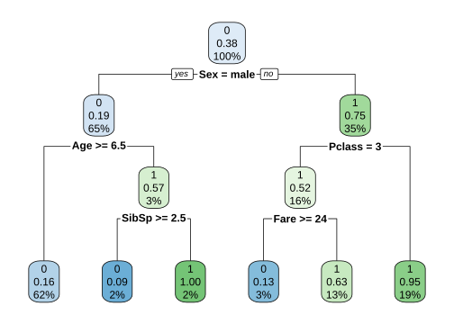</p>
</figure>

<!-- -->

::: {.callout-caution collapse="true"}
## Variable explanations

`0` corresponds to "Did Not Survive"; `1` corresponds to "Survived"

`Pclass:` Passenger Class. This is a categorical feature indicating the class of travel of the passenger aboard the Titanic. It typically has three categories: - 1 for first-class (the highest class), - 2 for second-class, - 3 for third-class (the lowest class).

`Sex:` The sex of the passenger (male or female). This is a binary categorical feature.

`Age:` The age of the passenger. This is a continuous numerical feature.

`SibSp:` The number of siblings or spouses the passenger had aboard the Titanic. This is a discrete numerical feature.

`Parch:` The number of parents or children the passenger had aboard the Titanic. This is also a discrete numerical feature. Note that some relations, like nannies or friends, may not be included in this count.

`Fare:` The amount of money the passenger paid for the ticket. This is a continuous numerical feature.
:::

**A few things to keep in mind**

-   A tree chooses a feature and a split point (e.g., if `Age >= 6.5`) to partition the data into subsets that are as homogeneous "pure" as possible (meaning that the node contains data points from predominantly one class)

    -   Just know there are measures for evaluating the "purity" of a node, e.g., Gini Impurity, Entropy, Classification Error

-   This process is repeated recursively, forming a tree structure until certain stopping criteria are met (e.g., when a node has a small number of observations, some maximum depth).

-   Trees are also **pruned** to reduce complexity and help prevent overfitting.

::: {.callout-note}
## INSTRUCTOR NOTE

A tree can continue splitting until it creates very small, highly specific groups. Pruning cuts back branches that add complexity without providing enough improvement in prediction. We may sacrifice a little accuracy on the training data, but gain a model that is more likely to work well on new data. 

:::

{.absolute top="-20" right="0" width="64" height="74"}

## Model Workflows
In tidyModels, we use something called a workflow to streamline our model-building process. Think of a workflow as a 'recipe' that combines data preprocessing and modeling steps into one neat package. This approach ensures that everything needed for our model to work --- from preparing the data to making predictions --- is bundled together.

Let's break down what each part of a workflow does and why it's helpful.

### What is a Workflow?
A workflow in tidyModels consists of two main parts:

-   Preprocessor: This handles all the data preparation tasks.

-   Model: This is where we specify the type of model we want to fit to our data.

#### Step 1: The Preprocessor
The preprocessor is responsible for preparing our data before it gets to the model. This can be as simple or complex as needed:

-   For straightforward tasks, we might use a simple formula like y \~ x1 + x2, which just tells the model what our target (y) and predictor variables (x1, x2) are.

-   For more complex tasks, we can use a **recipe.** Recipes are powerful because they let us add specific preprocessing steps like:

    -   Removing variables with no variance,
    -   Converting categorical variables into numeric 'dummy' variables,
    -   Handling missing data by filling in or categorizing NA values,
    -   Applying advanced techniques like PCA (Principal Component Analysis) to reduce the number of features

-   With recipes, we have a lot of flexibility in how we transform and prepare our data.

#### Step 2: The Model
Next, we specify the model we want to fit. This could be anything from a linear regression to a decision tree. In tidyModels, we can easily swap out different model types within the workflow without changing the preprocessing steps, allowing us to experiment with different approaches.

#### Why Use a Workflow?
-   **Consistency and Reproducibility:** When we apply a workflow to new data, it automatically uses the same preprocessing steps as with the training data. This consistency is important because it prevents any mismatch between training and testing data, helping us achieve more reliable results.

-   **Better Organization:** If you're experimenting with multiple models, workflows make it easier to keep track of each model's steps. Rather than manually re-running preprocessing each time, you have a ready-to-use workflow for each model, keeping things organized and clear.

-   **Improved Handling of New Data:** When we bring in new data that has slightly different values (e.g., new categories in a factor), workflows manage these changes more gracefully than base R. This makes workflows especially helpful in real-world applications where incoming data can vary.

{.absolute top="-20" right="0" width="64" height="74"} {.absolute top="-20" right="64" width="64" height="74"}

## A model workflow

<!-- -->

```{r}
#| label: tree-wflow
# Step 1: Specify the model with desired parameters
tree_spec <- 
  decision_tree(cost_complexity = 0.002) %>%  # Define model type 
  set_mode("classification")                   # Set mode to "classification" for binary outcomes

# Step 2: Build the workflow
tree_wflow <- workflow() %>% 
  add_formula(tip ~ .) %>%                     # Add the formula defining target and predictors. This is the "preprocessor" in this case
  add_model(tree_spec)                         # Attach the specified model

# Step 3: Fit the workflow to training data
tree_fit <- 
  tree_wflow %>% 
  fit(data = taxi_train)                       # Fit the workflow to the training dataset
```

<!-- -->

::: {.callout-tip}
## Tip


"Shortcut" by specifying the preprocessor and model specs directly in the `workflow()` call:

```r
workflow(tip ~ ., tree_spec) %>% 
  fit(data = taxi_train) 
```
:::

## Your turn
-   ### *Fill out the chunk below to create a workflow for a logistic regression model*

<!-- -->

```{r}
#| label: logi-wflow
# Step 1: Specify the model with desired parameters
# Here, create a logistic regression model specification
# Set the mode to "classification" since we're predicting a binary outcome
### logi_spec <- ...

# Step 2: Build the workflow
# Initialize a workflow object
# Add the formula (e.g., tip ~ .) to specify the target and predictors
# Attach the logistic regression model specified in Step 1
### logi_wflow <- ..

# Step 3: Fit the workflow to training data
# Use the fit() function to apply the workflow to the training (NOT TEST!) data (e.g., taxi_train)
### logi_fit <- ... 
```

{.absolute top="-20" right="0" width="64" height="74"}

## Pre-processing: Adding "recipes"
-   Hypothetical additions just for illustrative purposes

<!-- -->

```{r}
#| eval: false
# Define a preprocessing recipe with various steps
tree_rec <- 
  step_date(some_var1, features = c("dow", "month", "year")) %>%   # Extract date features like day of week, month, and year from a date variable
  step_rm(some_var1) %>%                                           # Remove the original date variable after extracting features
  step_dummy(all_nominal_predictors()) %>%                         # Convert categorical predictors into dummy (one-hot encoded) variables
  step_zv(all_predictors()) %>%                                    # Remove any predictors with zero variance (i.e., predictors that are constant)
  step_normalize(all_numeric_predictors()) %>%                     # Normalize all numeric predictors to have mean 0 and standard deviation 1
  step_pca(all_numeric_predictors())                               # Apply Principal Component Analysis (PCA) to reduce dimensionality of numeric predictors

# Build the workflow by combining the recipe and model
tree_wflow <- workflow() %>% 
  add_formula(tip ~ .) %>%                                         # Specify the formula for the target variable (tip) and predictors (all other columns)
  add_recipe(tree_rec) %>%                                         # Add the preprocessing recipe defined above
  add_model(tree_spec)                                             # Attach the specified model (e.g., decision tree model) to the workflow
```

-   Visit <https://www.tidymodels.org/find/recipes/> for details on all possible recipes

## How do we **understand** our new `tree_fit`/`logi_fit` models?
#### Predict with your model

Up to this point, we have used the training data to build the decision tree. The model has learned which predictors to use, where to split the data, and what class or probability to assign to each terminal node.

## What happens when you run predict(logi_fit, new_data = taxi_test)

```{r}
tree_fit %>%
  predict(new_data = taxi_test)
```

Add the predictions back into our dataset.

```{r}
taxi_results <- tree_fit %>%
  augment(new_data = taxi_test)

taxi_results
```

augment() passes each test observation through the fitted tree and adds the resulting class prediction and class probabilities to the original test data.

At this stage, the model is frozen: it does not learn from or change in response to the test data. The test observations simply follow the decision rules learned from the training data. The known test outcomes are used only to compare the model’s predictions with what actually happened.

::: {.callout-important}
The test set should be used only after model selection and tuning are complete. Repeatedly changing the model based on its test performance would allow information from the test set to influence model development, making it less useful as an unbiased evaluation of performance on new data.
:::

<!-- -->

::: {.callout-tip}
## The tidymodels prediction guarantee!


-   The predictions will always be inside a **tibble**
-   The column names and types are **unsurprising** and **predictable**
-   The number of rows in `new_data` and the output **are the same**
:::

#### Visualizing the fitted decision tree
<figure class="figure">
<p>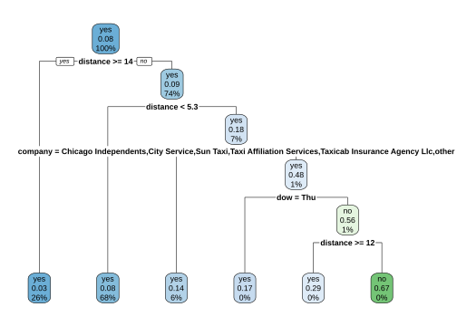</p>
</figure>

<!-- -->

::: {.callout-note}
## Additional methods for understanding models


-   Overall variable importance, such as with the [vip](https://koalaverse.github.io/vip/) package

-   Flexible model explainers, such as with the [DALEXtra](https://dalex.drwhy.ai/) package. *Works by removing a variable and see the effect on prediction, if the variable is important it will really wreck with the fit accuracy*
:::

Learn more at <https://www.tmwr.org/explain.html>

{.absolute top="0" right="0" width="150" height="150"}

## Your turn
-   ### *For the fitted logistic regression model, use `augment`, then `glance` and `tidy`. What happens with each?*

::: {.callout-caution collapse="true"}
`augment()` works at the observation level. It adds the predicted class and predicted probabilities to each row of the supplied data.

`glance()` works at the whole-model level. It produces a one-row summary containing overall model information such as AIC, BIC, deviance, log-likelihood, and the number of observations.

`tidy()` works at the predictor level. It produces one row for each model coefficient, including its estimate, standard error, test statistic, and p-value. For logistic regression, the estimates are in log-odds units unless they are exponentiated into odds ratios. The decision tree separately decides which predictors and cutoff values to use. We then compare the two models’ predictive performance using resampling or test data.
:::

{.absolute top="-20" right="0" width="64" height="74"}

# PART 4: Metrics for model performance

<!-- -->

::: {.callout-warning}
## Warning


In the following we will be working on evaluation metrics based on the training set data, but keep in mind that you also need to run the metrics on the test data. If you fail to do so, it can give a misleading impression of model performance. Hopefully this will be clearer soon.
:::


<!-- -->

```{r}
#| label: taxi-fit-augment
augment(tree_fit, new_data = taxi_train) %>%
  relocate(tip, .pred_class, .pred_yes, .pred_no)
```

## Confusion matrix
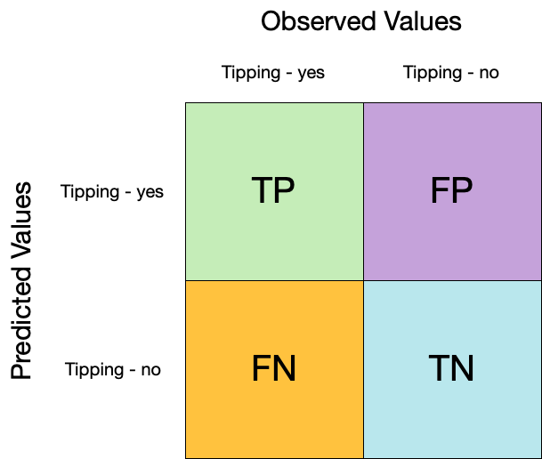{.img-fluid}

`conf_mat()` can be used to see how well the model is doing at prediction

<!-- -->

```{r}
#| label: conf-mat-plot
augment(tree_fit, new_data = taxi_train) %>%
  conf_mat(truth = tip, estimate = .pred_class) %>%
  autoplot(type = "heatmap")
```

## Accuracy
This is a straightforward measure of the proportion of correct predictions out of all predictions.

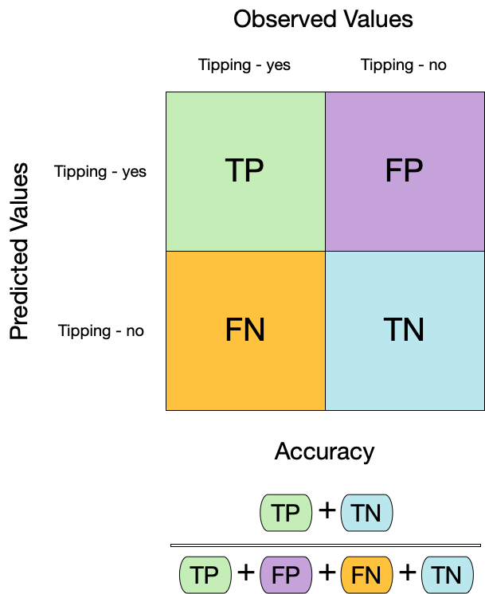{.img-fluid width="500"}

<!-- -->

```{r}
#| label: acc-2
augment(tree_fit, new_data = taxi_train) %>%
  mutate(.pred_class = factor("yes", levels = c("yes", "no"))) %>%
  accuracy(truth = tip, estimate = .pred_class)
```

<!-- -->

::: {.callout-warning}
## Dangers of accuracy


We need to be careful of using `accuracy()` since it can give "good" performance by only predicting one way with imbalanced data
:::

## Sensitivity
Where accuracy provides a quick understanding of how often the model is correct, sensitivity is an important measure when the cost of missing a positive case (false negative) is high. In our scenario, a positive case is the outcome variable coded as "1" (tip: yes). In other scenarios, this is more consequential (such as correctly predicting the percentage of sick people who have some targeted condition).

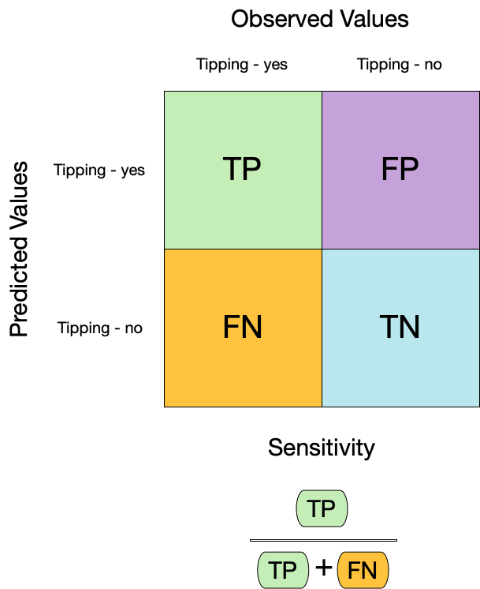{.img-fluid width="500"}

<!-- -->

```{r}
#| label: sens
augment(tree_fit, new_data = taxi_train) %>%
  sensitivity(truth = tip, estimate = .pred_class)
```

## Specificity
This is essentially the compliment of sensitivity. Specificity is an important measure of how well the model correctly predicts the true negative. In our scenario, a true negative is the outcome variable coded as "0" (tip: no). Pay attention to specificity when the cost of a false positive is high (like convicting an innocent person).

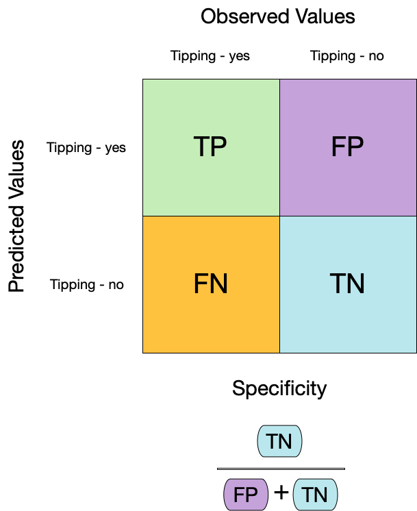{.img-fluid width="500"}

<!-- -->

```{r}
#| label: spec
augment(tree_fit, new_data = taxi_train) %>%
  specificity(truth = tip, estimate = .pred_class)
```

## Combining the metrics
We can use `metric_set()` to combine multiple calculations into a single table

<!-- -->

```{r}
#| label: taxi-metrics
taxi_metrics <- metric_set(accuracy, specificity, sensitivity)

augment(tree_fit, new_data = taxi_train) %>%
  taxi_metrics(truth = tip, estimate = .pred_class)
```

All yardstick metric functions work with grouped data frames!

<!-- -->

```{r}
#| label: taxi-metrics-grouped
taxi_metrics <- metric_set(accuracy, specificity, sensitivity)

augment(tree_fit, new_data = taxi_train) %>%
  group_by(local) %>%
  taxi_metrics(truth = tip, estimate = .pred_class)
```

{.absolute top="0" right="0" width="150" height="150"}

## Your turn
-   ## *Compute a confusion matrix for your logistic model and produce a table that shows its accuracy, specificity, sensitivity scores*

<!-- -->

::: {.callout-note}
## An important aside: Two class data


These metrics assume that we know the threshold for converting "soft" probability predictions into "hard" class predictions.

Is a 50% threshold good?

What happens if we say that we need to be 80% sure to declare an event?

-   sensitivity ⬇️, specificity ⬆️ In other words: more likely to predict negatives(no tips)

What happens for a 20% threshold?

-   sensitivity ⬆️, specificity ⬇️ In other words: more likely to predict positives(yes tips)


<figure class="figure">
<p>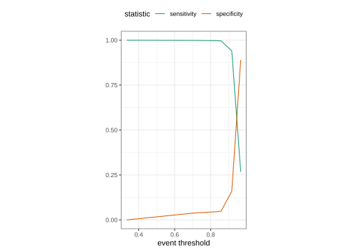</p>
</figure>
:::

{.absolute top="-20" right="0" width="64" height="74"}
::: {.callout-note}
## INSTRUCTOR NOTE

**LECTURE 1: STOP HERE!** 

:::


## ROC curves
An ROC curve, or Receiver Operating Characteristic curve, is a powerful visual tool that helps us evaluate how well our model distinguishes between two classes --- in our case, predicting a tip (yes) or no tip.

**What Does the ROC Curve Show Us?**

The ROC curve plots sensitivity (true positive rate) on the y-axis against 1 - specificity (false positive rate) on the x-axis, across all possible threshold values. This means:

-   Each point on the curve represents a different threshold.

-   The curve helps us see how sensitivity and specificity balance out as we adjust that threshold.

**Why Is This Useful?**

The ROC curve lets us understand how well our model separates positive and negative classes over a range of thresholds, rather than just one. This can reveal if the model maintains a good trade-off between correctly identifying tips and avoiding false positives as the threshold changes.

For example:

-   At lower thresholds, the model is more likely to predict 'yes tip,' which increases sensitivity but might lower specificity.

-   At higher thresholds, the model is stricter, predicting 'no tip' more often, which decreases sensitivity but increases specificity.

<!-- -->

::: {.callout-note}
## Why 1-sensitivity for FPR?


Given that sensitivity is the true positive rate, and specificity is the true negative rate. Hence `1 - specificity` is the false positive rate.
:::

**Here's the ROC curve for our model based on the training data:**

<!-- -->

```{r}
#| label: roc-curve
#| fig-width: 6
#| fig-height: 6
augment(tree_fit, new_data = taxi_train) %>% 
  roc_curve(truth = tip, .pred_yes) %>%
  autoplot() +
  labs(x="FPR, 1-specificity", y="TPR, or sensitivity")
```

**How do we interpret:**

A key takeaway from the ROC curve is the AUC (Area Under the Curve). The AUC gives us a single value that summarizes how well the model distinguishes between classes across all thresholds:

-   AUC = 1: Perfect separation of classes (ideal).

-   AUC = 0.5: No better than random guessing.

In general, a higher AUC means better performance. Our AUC value, shown here, helps us quickly assess the model's ability to separate classes across a wide range of thresholds.

-   ROC AUC = 1 💯
-   ROC AUC = 0.5 😢

**Let's get the actual value for AUC:**

<!-- -->

```{r}
#| label: roc-auc
augment(tree_fit, new_data = taxi_train) %>% 
  roc_auc(truth = tip, .pred_yes)
```

<!-- -->

::: {.callout-note}
## Note


ROC curves are insensitive to class imbalance.
:::

<!-- -->

::: {.callout-note}
## Note


Keep in mind that each point on the ROC curve corresponds to a specific threshold. While the curve shows us the balance of sensitivity and specificity visually, we can't see the exact thresholds on the curve itself. To pinpoint a particular threshold, we'd need to look at our data.
:::

{.absolute top="0" right="0" width="150" height="150"}

## Your turn
-   ### *Compute and plot an ROC curve for your logistic model*
# Recap so far

Alright, where are we at with things:

We created a workflow for a decision tree/logistic regression model to predict tips. Here's a reminder of what each part does:

-   `tree_fit`/`logi_fit`: This is our final, trained model. We built it by:
    -   Specifying a model with classification mode.

    -   Using a workflow (`tree_wflow`/`logi_wflow`) to package the preprocessing steps (formula and recipe) and model together.

    -   Fitting this workflow to the training dataset (`taxi_train`), resulting in `tree_fit`/`logi_fit`.

    -   We have taken `tree_fit`/`logi_fit` and determined how well it performs with the training dataset based (computing a bunch of metrics along the way)

Dataset Reminder --- `taxi_test`:

-   `taxi_test` is our test dataset that we held out during training.
-   We'll use `taxi_test` to evaluate how well `tree_fit`/`logi_fit` performs on new, unseen data.

# PART 5: Using resampling to estimate performance

## ⚠️ Dangers of Overfitting ⚠️
Models can easily be overfitted to the training data, meaning they perform well on the training data but poorly on unseen data.

#### Fitting to your training data
{.img-fluid}

#### Problems when generalizing to test data
{.img-fluid}

## Is our model doing well on training but poorly on new data?
#### Here's our model performance on the training data

<!-- -->

```{r}
#| label: augment-train
tree_fit %>%
  augment(taxi_train)
```


<!-- -->

```{r}
#| label: augment-acc
tree_fit %>%
  augment(taxi_train) %>%
  accuracy(tip, .pred_class)
```

#### Here's our model performance on the test data (unseen data)

<!-- -->

```{r}
#| label: augment-acc-test
tree_fit %>%
  augment(taxi_test) %>%
  accuracy(tip, .pred_class)
```

The comparison between training accuracy and test accuracy are very close: 0.924 vs. 0.914. What does this mean?

-   The model generalizes reasonably well (good!)
-   **Or** that your test set may not be large or representative enough to fully assess generalization

This comparison alone doesn't give us the full picture. It's not enough.

Why? Because this evaluation depends on just one split of the data into training and test sets. If this split isn't representative of all possible data scenarios, it could lead to overly optimistic or overly pessimistic results.

#### Better to first fit on training data via a process of resampling
To truly understand how well our model performs, we need to use resampling techniques like cross-validation.

Cross-validation gives us multiple test scenarios by repeatedly splitting the training data and evaluating the model on different subsets. This not only gives us a more robust estimate of performance but also highlights whether the model might be overfitting or underfitting.

## V-fold (K-fold) Cross-validation
We want to repeatedly sample ("fold") the training data to create unique subsets (e.g., Resample 1, Resample 2, Resample *B*) for analysis and assessment.

We randomly split the training data into V (or K) distinct blocks of roughly equal size (AKA the "folds").

{.img-fluid}

<figure class="figure">
<p></p>
</figure>

#### In Fold 1:
-   We leave out the first block of analysis data and fit a model

-   This model is used to predict the held-out block of assessment data

-   We continue this process until we've predicted all V assessment blocks

-   This process ensures that every observation from the original dataset has the chance of appearing in the analysis and assessment set

{.img-fluid}

<!-- -->

::: {.callout-tip}
## Other advantages of resampling with V-fold cross-validation


-   **Efficient use of data:** When the amount of data is limited, it's a way to use every data point in both the training and validation

-   **Model tuning:** Useful method for selecting the model with the best tuning parameters (hyperparameters). You can perform cross-validation for various combinations of parameters and choose the one that performs best.

-   **Comparing models** What if we want to compare more models to see if there are important differences? Cross-validation allows us to do just this with just the *training* data
:::

{.absolute top="0" right="0" width="150" height="150"}

## Your turn
-   ### *If we use 10 folds, what percent of the training data ends up in ANALYSIS for each fold? for ASSESSMENT for each fold?*
{.absolute top="-20" right="0" width="64" height="74"}

## Let's do some cross-validation

<!-- -->

```{r}
#| label: vfold-cv
taxi_folds <- vfold_cv(taxi_train) # v = 10 is default
taxi_folds
```

<!-- -->

::: {.callout-note}
## Note


These separate sets are in a list column, which is a way to store non-atomic types in a dataframe
:::

#### We can do this with how many folds we want

<!-- -->

```{r}
#| label: vfold-cv-v
vfold_cv(taxi_train, v = 5)
```

#### Stratification often helps, with very little downside

<!-- -->

```{r}
#| label: vfold-cv-strata
vfold_cv(taxi_train, strata = tip)
```

### We'll use this setup:

<!-- -->

::: {.callout-important}
## Important


Set the seed when creating resamples
:::


<!-- -->

```{r}
#| label: taxi-folds
set.seed(123)
taxi_folds <- vfold_cv(taxi_train, v = 10, strata = tip)
taxi_folds
```

## Fit our model to the resamples!
#### We will fit 10 models on 10 slightly different analysis sets.

<!-- -->

```{r}
#| label: fit-resamples
taxi_res <- fit_resamples(tree_wflow, taxi_folds)
taxi_res
```

{.absolute top="0" right="0" width="150" height="150"}

## Your turn
-   ### *Now run `vfold_cv` to get 10 splits and refit your logistic regression workflow (using `fit_resamples`)*
{.absolute top="-20" right="0" width="64" height="74"}

## Evaluating model performance
-   The goal of resampling is to produce a single estimate of performance for a model
-   The final performance is based on the hold-out predictions by averaging the statistics from the V folds.

<!-- -->

```{r}
#| label: collect-metrics
taxi_res %>%
  collect_metrics()
```

<!-- -->

::: {.callout-note}
## Note


Even though we end up estimating V models, these models are discarded after we have our performance estimate. 🗑
:::

### We can reliably measure performance using only the **training** data 🎉

<!-- -->

::: {.callout-note}
## Note


`collect_metrics()` is one of a suite of `collect_*()` functions that can be used to work with columns of tuning results. Most columns in a tuning result prefixed with `.` have a corresponding `collect_*()` function with options for common summaries.
:::

{.absolute top="0" right="0" width="150" height="150"}

## Your turn
-   ### *Use `collect_metrics()` to get a single estimates of performance on your cross-validated logistic regression*
-   ### *Generate a new confusion matrix for your cross-validated logistic regression*
### Compare model performance with all the training data vs. resampling (subsets of training data)
#### ROC AUC from all the training data:

<!-- -->

```{r}
#| label: roc-auc-2
augment(tree_fit, new_data = taxi_train) %>% 
  roc_auc(truth = tip, .pred_yes)
```

#### ROC AUC from resampling (subsets of training data):

<!-- -->

```{r}
taxi_res %>%
  collect_metrics() %>% 
  select(.metric, mean, n)
```

#### All the training data was slightly optimistic (**0.611**), resampling gives us a better estimate of expected performance (**0.592**).
## Recap of proper workflow
1.  Split the Data into Training and Testing Sets
2.  Specify the Model
3.  Preprocess the Data with Recipes (Optional)
4.  Create a Workflow
5.  Validate the Model with Resampling (e.g., Cross-Validation)
6.  Fit the Final Model (using all the training data)
7.  Test the Final Model

## What you would report
#### Training Performance (Cross-Validation)
Summarize the model's expected performance on unseen data, using the mean and standard deviation of metrics across folds. This gives an indication of how well the model is expected to perform on unseen data, taking into account the variability due to different subsets of the training data.

-   Present metrics that summarize the model's performance across the folds
    -   Accuracy: mean and standard deviation
    -   Sensitivity
    -   Specificity
    -   AUC

#### Verify Performance w/ Test Data
Present metrics for the final model evaluated on the test set to show its actual generalizability. The performance metrics derived from the held-out test set give the reader an understanding of how the model performs on completely unseen data. This is the ultimate test of the model's generalizability.

<!-- -->

```{r}
taxi_metrics <- metric_set(accuracy, specificity, sensitivity)

augment(tree_fit, new_data = taxi_test) %>% ## NOTE: switched out taxi_train for taxi_test
  taxi_metrics(truth = tip, estimate = .pred_class)
```


<!-- -->

```{r}
augment(tree_fit, new_data = taxi_test) %>% 
  roc_auc(truth = tip, .pred_yes)
```

#### Overfitting Discussion
Discuss any signs of overfitting observed (for instance, if there was a large discrepancy between the cross-validation performance and the test set performance).

#### Model Interpretability
It's often important to discuss what the model's parameters or predictions mean in the context of the subject area.

{.absolute top="0" right="0" width="150" height="150"}

## Your turn
-   ### *Generate a final report for your regression logistic model, but now using the test set*
## Completing the whole game
{.img-fluid}

# PART 6: Next Steps?

## Adjust the threshold setting
## Random forest 🌳🌲🌴🌵🌳🌳🌴🌲🌵🌴🌳🌵
-   Ensemble many decision tree models
    -   All the trees vote! 🗳️
    -   Bootstrap aggregating + random predictor sampling

## Model tuning
-   Requires tuning model parameters with more advanced machine learning methods
    -   Growing phase; tree pruning
        -   Grid search
        -   Iterative search
    -   Nice resource: <https://topepo.github.io/2022-nyr-workshop/5-tuning.html#1>

## Variable importance
-   `vip` package

## Alternate resampling schemes: Bootstrapping
-   Assess model accuracy and stability

-   From your original training dataset, create many (often thousands) of new "bootstrap" training datasets by sampling with replacement.

{.img-fluid}

-   After running the bootstrap process many times, you'll end up with a distribution of performance metrics (like accuracy or AUC).

**Handling Small Datasets:** It is particularly useful when dealing with small datasets where you might not be able to afford to set aside a portion of the data as a test set.

**Uncertainty Estimates:** It provides a way to create confidence intervals for various performance metrics, giving a sense of how uncertain those metrics are.

<!-- -->

```{r}
#| label: bootstraps
set.seed(3214)
bootstraps(taxi_train)
```

<https://rsample.tidymodels.org/reference/index.html>
