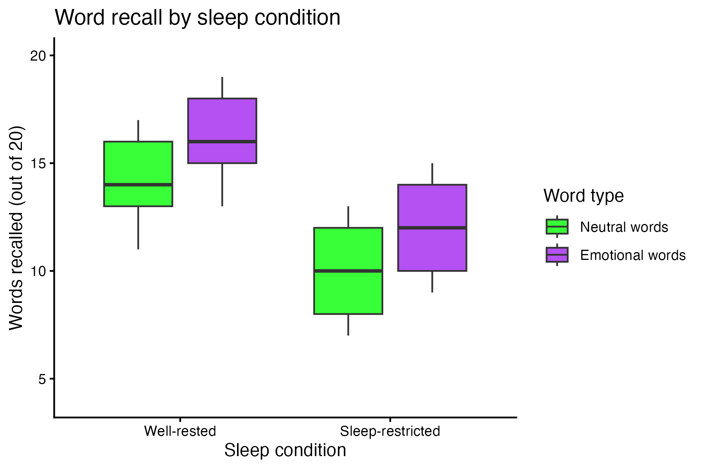

```{r load-pkg, echo = FALSE, message = FALSE, eval = FALSE}

library(tidyverse)

```

## Background

Researchers tested whether sleep restriction affects memory for emotional and neutral words. Participants were assigned to either a well-rested condition with eight hours of sleep or a sleep-restricted condition with four hours of sleep. The next morning, participants completed a recall task containing 20 neutral words and 20 emotional words.

Your goal is to import, inspect, clean, recode, filter, and reshape the data so that you can reproduce (*exactly!*) the target figure below. All features of the graph need to be *exactly the same* as the image below to receive full credit!

The data (in the `data` folder) is called `sleep_memory_messy.csv`



## The data

The file `sleep_memory_messy.csv` contains one row per participant:

- `participant_id`: anonymous participant ID
- `age`: participant age in years
- `sleep_group`: assigned sleep condition
- `test_order`: whether neutral or emotional words were tested first
- `neutral_recall`: number of neutral words recalled
- `emotional_recall`: number of emotional words recalled
- `attention_check`: whether the participant passed an attention check

The data begin in **wide format**, with neutral and emotional recall in separate columns. The dataset also includes inconsistent categorical labels, numeric values stored as text, missing-value codes, exact duplicates, failed attention checks, and impossible recall scores.

## Questions to consider:

- What does one row represent?
- Is the dataset in wide or long format?
- Which columns contain repeated measurements of the same outcome?
- Does each participant contribute more than one memory score?
- Which variable identifies participants?
- How are the sleep conditions coded?
- How are the stimulus types encoded in the column names?
- Are capitalization, spelling, or spacing consistent within categorical variables?
- Are the memory scores stored as numeric data?
- How are missing values represented?
- Are any values outside the possible range?
- Which variables are needed on the x-axis and y-axis of the boxplot?
- Should each participant contribute one or multiple observations to the final graph?

Hint 1: The cleaned data that you summarize to create the graph should have 83 rows.

Hint 2: Colors used in the plot are `green` and `purple`.


