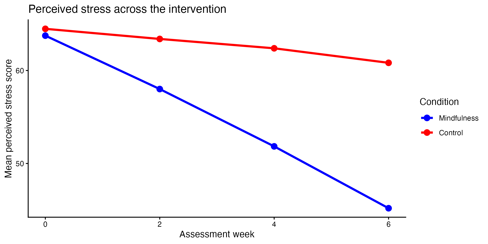

```{r load-pkg, echo = FALSE, message = FALSE, eval = FALSE}

library(tidyverse)

```

## Background

Researchers examined whether a six-week mindfulness program reduced perceived stress. Forty adults were assigned to either a mindfulness intervention or a waitlist control group. Participants completed a perceived-stress measure at baseline and at Weeks 2, 4, and 6. Scores can range from 0 to 100, with higher scores indicating greater stress.

Your goal is to import, inspect, clean, recode, filter, and summarize the data so that you can reproduce (*exactly!*) the target figure below. All features of the graph need to be *exactly the same* as the image below to receive full credit!

The data (in the `data` folder) is called `mindfulness_stress_messy.csv`



## The data

The file `mindfulness_stress_messy.csv` contains:

- `participant_id`: anonymous participant ID
- `age`: participant age in years
- `condition`: intervention condition
- `assessment`: assessment occasion
- `stress_rating`: perceived-stress score
- `use_data`: whether the participant's data should be included

The dataset includes inconsistent categorical labels, numbers stored as text, missing-value codes, exact duplicates, excluded participants, and impossible stress scores.

## Questions to consider:

- What does one row represent?
- Are there repeated observations from the same participant?
- Which variable identifies participants?
- How are the experimental conditions coded?
- Are capitalization, spelling, or spacing consistent within categorical variables?
- How are the study weeks coded, and in what order should they appear?
- Is the stress-score variable stored as numeric data?
- Are missing values represented consistently?
- Are there values that are impossible or outside the expected range?
- Should missing observations be removed before calculating means?
- At what level should the data be summarized to create the line graph?
- Which variables should determine the line color and grouping?

Hint 1: The cleaned data that you summarize to create the graph should have 139 rows.

Hint 2: The y axis is a _mean_ stress score.

Hint 3: Colors used in the plot are `red` and `blue`.
